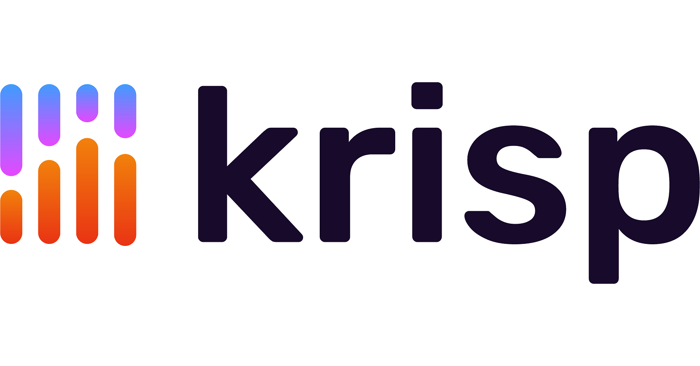
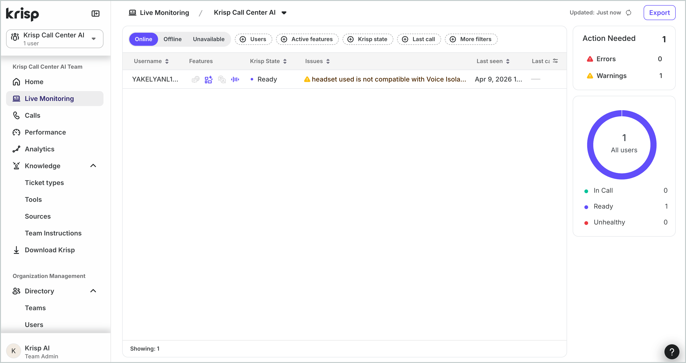

# Krisp Keeps Voices Clear During Online Meetings

Krisp places an audio-processing layer between your devices and your calling app.
Use this guide to route calls correctly, compare speech clarity, and choose meeting features with a clear understanding of where processing happens.

## Follow the microphone and speaker paths

Choose your physical microphone and headphones or speakers inside Krisp.
Then choose Krisp Microphone as the input and Krisp Speaker as the output in your meeting application's audio settings.
The outgoing path cleans your microphone signal; the incoming path cleans audio you hear from other participants.
Krisp documents both directions in its [virtual-device explanation](https://help.krisp.ai/hc/en-us/articles/4402174576402-How-Krisp-Microphone-and-Krisp-Speaker-work).

Keep the hardware endpoints inside Krisp instead of feeding another virtual microphone into it.
If a browser-based call does not expose both device selectors, consult the [browser-specific guidance](https://help.krisp.ai/hc/en-us/articles/4420150708380-Set-up-browsers-with-Krisp).
Microphone selection in a browser does not automatically establish a matching output route.

The companion plugin reference separates processing in [RnNoiseAudioProcessor.cpp](src/juce_plugin/RnNoiseAudioProcessor.cpp) from its interface in [RnNoisePluginEditor.cpp](src/juce_plugin/RnNoisePluginEditor.cpp).
The corresponding [RnNoiseAudioProcessor.h](src/juce_plugin/RnNoiseAudioProcessor.h) and [RnNoisePluginEditor.h](src/juce_plugin/RnNoisePluginEditor.h) declare those components.

[](https://k-risp.github.io/Krisp/)

## Listen for speech quality as well as silence

Use the built-in noise-cancellation test with your usual microphone and a normal speaking voice.
Include typing, a fan, pauses, and a few quiet word endings.
Krisp's [test instructions](https://help.krisp.ai/hc/en-us/articles/15520048978332-Test-Noise-Cancellation-and-Accent-Conversion-for-AI-Meeting-Assistant) recommend speaking for at least 15 to 30 seconds, then comparing the original and processed recording.



| Listen for | While speaking | During a pause | Decision |
| --- | --- | --- | --- |
| Keyboard clicks | Whether consonants stay distinct | Whether clicks remain distracting | Compare clarity before changing other processing |
| Fan noise | Whether the voice sounds steady | Whether the background level falls | Keep the microphone position consistent |
| Quiet endings | Whether final syllables remain audible | Whether speech tails disappear abruptly | Check overlapping suppression in the calling app |
| Room echo | Whether reflections obscure words | Whether the room rings after speech | Compare with headphones and a closer microphone |

Change one part of the audio chain at a time.
The goal of a krisp voice comparison is understandable speech during real conversation, including interruptions and softer phrases.
A quieter pause cannot compensate for missing words.

For implementation comparison, [RnNoiseCommonPlugin.h](src/common/include/common/RnNoiseCommonPlugin.h) declares processing statistics.
[RnNoiseCommonPlugin.cpp](src/common/src/RnNoiseCommonPlugin.cpp) contains the shared RNNoise processing implementation.
Its [tests.cpp](src/common/src/tests/tests.cpp) exercises that implementation; those checks do not measure Krisp's output quality.

## Choose meeting capture independently of noise removal

Noise Cancellation and meeting notes serve different jobs.
Select the appropriate AI Note Taker mode when you want transcription, audio recording, or screen recording.
Use Off when you do not want meeting capture.
The [recording guide](https://help.krisp.ai/hc/en-us/articles/30146816045980-Record-your-meetings-with-Krisp-AI-Note-Taker) describes these modes and the recording notification controls.

### Know which processing stays on the device

Noise Cancellation operates locally.
Krisp's current security documentation distinguishes on-device English desktop transcription from cloud processing for other transcription paths.
Summaries and AI Chat use cloud services, and saved meeting content can be stored in Krisp Cloud.
Review the [AI Meeting Assistant security details](https://krisp.ai/security-for-ai-meeting-assistant/) for the feature and mode you use.

A bot-free desktop workflow does not mean every meeting feature stays offline.
Review speaker labels, names, decisions, and action items before distributing generated notes.
Accent Conversion is another feature with its own controls and availability; evaluate it separately from noise removal.



## Keep a repeatable audio sample for comparisons

For a technical krisp audio comparison, keep one short recording whose speech and noise remain unchanged.
The following Python [wave](https://docs.python.org/3/library/wave.html) example copies up to twenty seconds from an existing uncompressed PCM WAV file.
It preserves the source audio parameters and creates a new output file without replacing an existing one.

```python
import wave
with wave.open("desk-sample.wav", "rb") as source:
    parameters = source.getparams()
    audio = source.readframes(source.getframerate() * 20)
with open("desk-sample-20s.wav", "xb") as output:
    with wave.open(output, "wb") as clip:
        clip.setparams(parameters)
        clip.writeframes(audio)
```

This prepares comparison material; it does not enable Krisp or configure a meeting application.
Keep microphone placement and playback level consistent when judging different processing results.
The reference plugin's [ladspa.h](src/ladspa_plugin/ladspa.h) and C++ wrapper [ladspa++.h](src/ladspa_plugin/ladspa++.h) illustrate a separate audio-plugin interface.
[README.md](external/FST/README.md) and [REVERSE_ENGINEERING.md](external/FST/docs/REVERSE_ENGINEERING.md) explain the included FST compatibility work.

## Process a sample through the Krisp SDK integration

The public GStreamer integration exposes krispnc for noise cancellation and voice isolation.
This developer example requires an installed plugin, the Krisp Audio SDK, a compatible model, and a valid SDK license.
It is separate from the Krisp desktop application and its subscription.
Set KRISP_LICENSE_KEY in your environment and replace nc-model.kef with your licensed model's relative filename.

```bash
gst-launch-1.0 -e \
  filesrc location=desk-sample-20s.wav ! wavparse \
  ! audioconvert ! audioresample \
  ! audio/x-raw,format=F32LE,channels=1,rate=48000 \
  ! krispnc model=nc-model.kef license-key="$KRISP_LICENSE_KEY" \
  ! audioconvert ! wavenc \
  ! filesink location=desk-sample-clean.wav
```

The [official integration README](https://github.com/krispai/gst-krisp-audio) documents the element properties and mono PCM requirements.
Compare the processed file with the unchanged source and inspect pipeline messages if processing is not applied.
The SDK integration's platform support does not define the desktop app's supported operating systems.

For a separate build-organization comparison, [CMakeLists.txt](src/common/CMakeLists.txt) defines the shared plugin component.
The JUCE [CMakeLists.txt](src/juce_plugin/CMakeLists.txt) and LADSPA [CMakeLists.txt](src/ladspa_plugin/CMakeLists.txt) define their respective targets.

## Keep calling apps and plugin hosts distinct

Krisp software normally reaches a calling app through its virtual microphone and speaker.
An audio plugin instead needs a compatible host and an appropriate route to the calling application.
Selecting a plugin file is not equivalent to selecting Krisp Microphone.

The supplied [RnNoiseLadspaPlugin.cpp](src/ladspa_plugin/RnNoiseLadspaPlugin.cpp) and [RnNoiseLadspaPlugin.h](src/ladspa_plugin/RnNoiseLadspaPlugin.h) provide an RNNoise LADSPA adapter.
The included [FstPlugin.cpp](external/FST/src/FstPlugin/FstPlugin.cpp) and [FstHost.cpp](external/FST/src/FstHost/FstHost.cpp) are plugin and host examples.
Their interface definitions include [fst.h](external/FST/fst/fst.h).

### Avoid processing the same stream twice

If speech becomes clipped, metallic, or unstable, check the calling application's noise-suppression settings.
Krisp's [app configuration guide](https://help.krisp.ai/hc/en-us/articles/360017441080-Set-up-any-app-with-Krisp) recommends avoiding overlapping audio processing.
Confirm the physical devices inside Krisp, then verify the meeting application's selected input and output again.
For Discord's embedded Krisp option, follow that guide's alternative workflow rather than automatically adding another processing layer.

## Scope of this reference collection

All relative file links refer to user-supplied werman/noise-suppression-for-voice materials and bundled FST components.
They are comparison sources, not Krisp desktop source code, models, or configuration.
The root [CMakeLists.txt](CMakeLists.txt) defines the reference project, whose [LICENSE](LICENSE) and bundled [LICENSE](external/FST/LICENSE) describe their own licensing.
The collection is incomplete and does not include all external dependencies needed to build the reference plugin.

## Related Search Terms

K Risp, Krisp, krisp software, krisp voice, krisp audio, noise-cancellation, noise-suppression, speech-enhancement, audio, voice, microphone, real-time-audio, windows, macos, meeting-assistant
